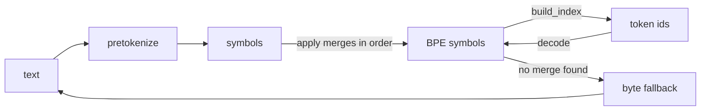

<p align="center">
  <em>Train a byte-level BPE tokenizer from scratch, save it, ship it — no dependencies.</em>
</p>

<p align="center">
  
  
  
</p>

---

Byte-level BPE, the tokenization scheme behind GPT-style models, in a package you
can read end to end. Train a vocabulary on your own corpus, save it to JSON, load
it anywhere.

A 255-merge English vocabulary ships with the library, so it is useful the moment
it is imported.

## Quick start

```python
from forge import BPETokenizer, load, available

available()                     # ['english']

tok = BPETokenizer(load("english"))
ids = tok.encode("The quick brown fox jumps over the lazy dog.")
print(len(ids))                 # 11
print(tok.decode(ids))          # 'The quick brown fox jumps over the lazy dog.'
```

Train your own:

```python
from forge import BPETrainer

trainer = BPETrainer(vocab_size=512)
vocab = trainer.train(["your corpus text here", "and more of it"])
vocab.save("my-bpe.json")

tok = BPETokenizer(vocab)
```

```bash
python -m forge.cli train --corpus corpus.txt --vocab-size 512 --out my-bpe.json
python -m forge.cli encode "hello world" --vocab my-bpe.json
python -m forge.cli info          # list bundled vocabularies
```

## What it does

| Piece | Role |
|---|---|
| `BPETrainer` | Learns merge rules from a corpus up to a target vocabulary size |
| `Vocabulary` | The learned state: ordered `(left, right)` merges + special tokens |
| `BPETokenizer` | Applies merges to text; byte-level fallback for anything unseen |
| `pretokenize` | Splits text into the units merges operate on |
| `ALPHABET` / `ByteAlphabet` | The 256 base byte symbols |
| `available()` / `load()` | Bundled vocabularies (`"english"`, 255 merges) |

## Byte-level fallback

Any character outside the learned vocabulary still round-trips: it falls back to
raw bytes rather than producing `<unk>`. That is why `decode(encode(x)) == x`
holds for arbitrary input, not just the corpus the tokenizer was trained on.



## Install

Copy the `forge/` directory into your project. No `pip install`, no build step.

## Tests

```bash
python -m unittest discover -s tests
# Ran 37 tests — OK
```

## Limitations

- **The bundled vocabulary is small.** 255 merges is enough to demonstrate the
  mechanism and handle ordinary English; it will fragment rare words and non-English
  text much more than a production tokenizer.
- **Training is single-threaded and O(n·merges).** Fine for a few megabytes of
  corpus, wrong for a pretraining-scale dataset.
- **No `tiktoken` compatibility.** The encoding is BPE but the vocabulary layout is
  its own; you cannot load an OpenAI `.tiktoken` file.
- **No normalisation layer.** No Unicode NFC folding, no lowercasing — what you pass
  in is what gets tokenized.

## License

MIT
